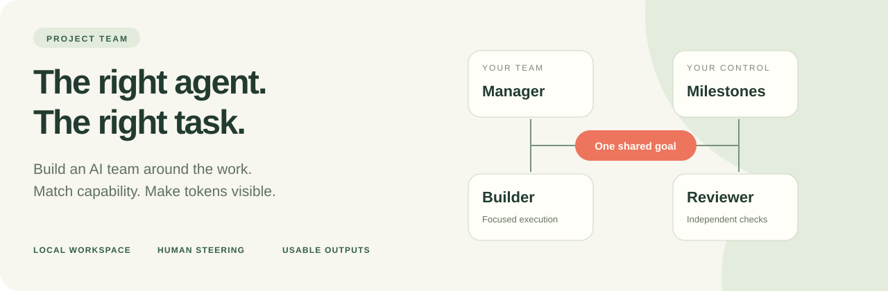
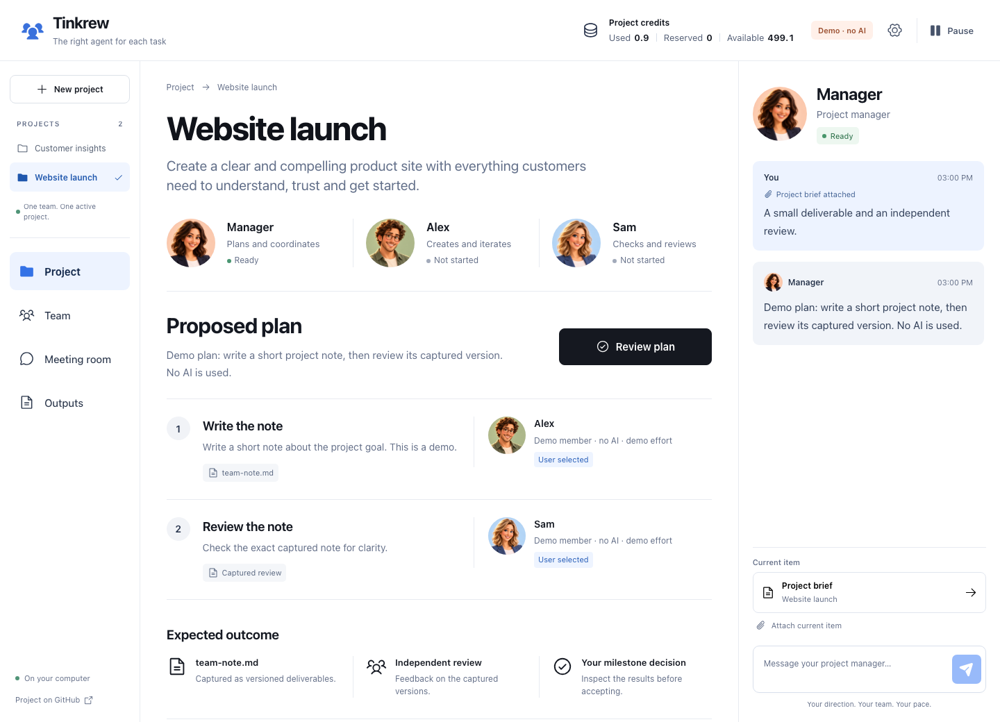

<p align="center">
  
</p>

<p align="center">
  <strong>Your ideas. Your crew. One thoughtful task at a time.</strong><br/>
  Match roles, model capability and reasoning effort to each task. Keep token usage visible. Review useful deliverables.
</p>

<p align="center">
  <a href="#try-the-demo">Try the demo</a> · <a href="#how-it-works">How it works</a> · <a href="docs/architecture.md">Architecture</a> · <a href="docs/privacy.md">Data &amp; privacy</a> · <a href="CONTRIBUTING.md">Contribute</a>
</p>

## Why Tinkrew?

A small edit, a difficult implementation and an independent review call for different kinds of attention. Tinkrew helps you make those choices deliberately: assemble a team, give each member a clear role, choose an available model and reasoning effort, and steer the work through milestones.

The goal is **appropriate capability for the task**. Keep routine work focused, bring deeper reasoning to difficult problems, and give verification its own perspective. The team shares captured deliverables so work can move from planning to building to review.

| Work to do | A fitting team responsibility |
| --- | --- |
| Clarify the outcome and break it into tasks | A manager who proposes a plan for your approval |
| Make a small, well-scoped change | A focused builder with a suitable model and reasoning effort |
| Work through a demanding implementation | A builder configured for deeper reasoning |
| Check a result independently | A reviewer who reads the exact captured version |

**Current behavior:** you choose team members, models and reasoning effort; the manager proposes assignments within the approved workflow. Automatic model routing and measured token savings are future work. A model label is not a guarantee of lower usage—judge actual reported tokens and output quality.

## How it works

1. **Give your idea a home.** Create a saved project, choose its own folder and set a token allowance.
2. **Build your shared team.** Hire builders and reviewers with responsibilities, models and supported reasoning settings that fit the work.
3. **Approve a plan.** The manager proposes tasks and milestones. Work starts after your approval.
4. **Build, hand off, review.** One agent works at a time. Members use immutable output versions, and feedback creates new versions.
5. **Steer at milestones.** Accept outputs, request changes, discuss alternatives in a meeting, pause or resume. Export chosen versions to GitHub when ready.

<p align="center">
  
  <br/><sub>Disposable demo data and generated fictional portraits. No real account, private project or live AI conversation is shown.</sub>
</p>

## What is built

- **Saved projects:** keep several projects and switch one shared team between them. Conversations, work, outputs and credits stay with their project.
- **Distinct characters:** each member has a persistent original animated portrait, even when two members share a role.
- **Team composition:** discover the available Codex model catalog; choose each hired member's model, responsibility and reasoning effort.
- **Manager-led work:** proposed plans, sequential execution, explicit approvals and milestone gates.
- **Useful outputs:** versioned files, captured handoffs, independent reviews and revisions.
- **Open meetings:** address participants and confirm the manager's proposed changes before they apply.
- **Usage visibility:** token-based project credits, per-member usage, reservations and separate account quota information.
- **Durable controls:** Pause, Resume, graceful Stop and recovery that checks saved work before retrying it.
- **Selected GitHub checkpoints:** preview and export exact versions, with visible unsynced failures and bounded retries.
- **Storage management:** private run histories, disk-usage reporting, retention, cleanup and execution budgets.

**Status: early alpha.** The current implementation targets a personal workspace with multiple saved projects and one active team on macOS with Node.js 24+ and Codex. The demo works without a model connection. Live execution depends on compatible Codex authentication and permission support; it stays disabled when that boundary cannot be verified.

## Try the demo

Requires **Node.js 24 or newer**.

```sh
git clone https://github.com/MMischak/project-team-public.git
cd project-team-public
npm ci
npm run demo
```

Open [localhost:4173](http://127.0.0.1:4173). Create a demo project using an existing disposable folder. Demo mode simulates replies and outputs; it does not call an AI provider.

## Run with Codex

Use an existing ChatGPT sign-in in the official Codex client. For GitHub checkpoint exports, also configure Git and the GitHub CLI for your own repository.

```sh
npm run build
npm start -- --open
```

On macOS you can also double-click **StartProjectTeam.command**. Choose your project folder, start the manager connection, hire your team and approve its plan. Closing the browser keeps the coordinator running; use **Stop local coordinator** in settings to shut it down.

One project credit represents **1,000 reported tokens**. Credits are a usage allowance, not money or a guaranteed billing cap. Account quota is displayed separately.

## Data stays under your control

This public repository contains application source and synthetic examples. Your projects, prompts, credentials, runtime databases and session histories are not part of it.

The application stores state locally, outside the agents' writable project folder. New model sessions use app-owned history directories. Model requests still send the supplied task context to the provider; local state does not mean offline inference. GitHub publishing is a separate, explicit action with a preview of selected files.

Default storage budgets are **1 GiB shared across all saved projects’ app run data**, **2 GiB for the selected project folder**, **64 MiB for diagnostics** and **seven days for completed native traces**. Cleanup protects deliverables, saved conversations, credits, recovery and exports. Budgets pause new work; an active command can overshoot before the next check. Other Codex chats and shared tool caches are excluded from automatic deletion.

Read the [data and privacy guide](docs/privacy.md) before using a real project.

## Development

```sh
npm test
npm run build
npm run check:publication
```

The automated suite uses isolated fixtures and does not require live inference. Browser checks use Playwright; native diagnostic commands are opt-in and described in [CONTRIBUTING.md](CONTRIBUTING.md).

The interface follows the [workspace design language](docs/design.md), with [documented design verification](design-qa.md).

The next steps are better suggestions for matching tasks to members/models, tighter task context, and benchmarks that compare token usage with deliverable quality. See the [roadmap](docs/roadmap.md).
