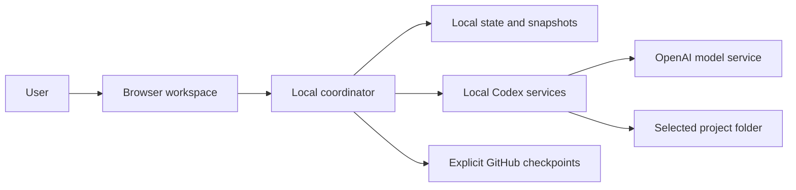

# Architecture

Project Team is a React interface served by a loopback Node.js coordinator. The coordinator owns scheduling, SQLite state, output capture, usage accounting and publishing authority.

The manager/meeting service supports discussion and structured proposals. A separate worker service exposes only the declared project tools under a verified native permission profile. There is one active model turn. Teamwork means distinct roles, captured handoffs and reviews; it does not imply concurrent agent execution.

A step's identity and estimated token reservation are saved before dispatch. Reported cumulative usage settles that reservation once. Missing usage stays visibly estimated. Restart never replays a dispatched turn automatically.

Outputs are captured as immutable text/source snapshots. Reviews and handoffs name the exact version, and milestone acceptance releases dependent work. GitHub export uses coordinator-owned CLI authentication and creates a dedicated snapshot branch without staging or editing the selected project's working tree.

Runtime state belongs outside the project folder. New native histories use private app-owned directories. Storage gates apply before reservations/dispatch and around worker commands; cleanup protects saved deliverables, recovery, usage records and exports. These guards are not filesystem quotas.
