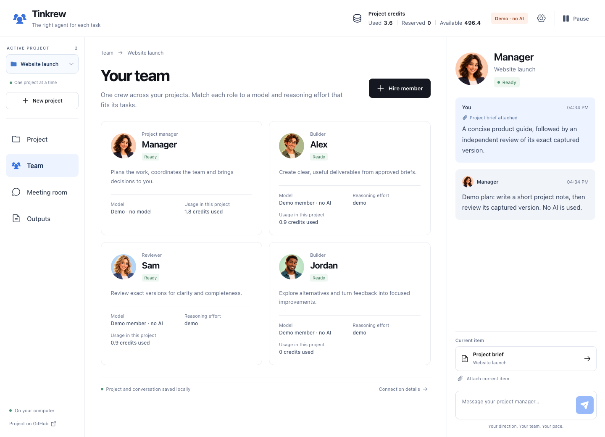
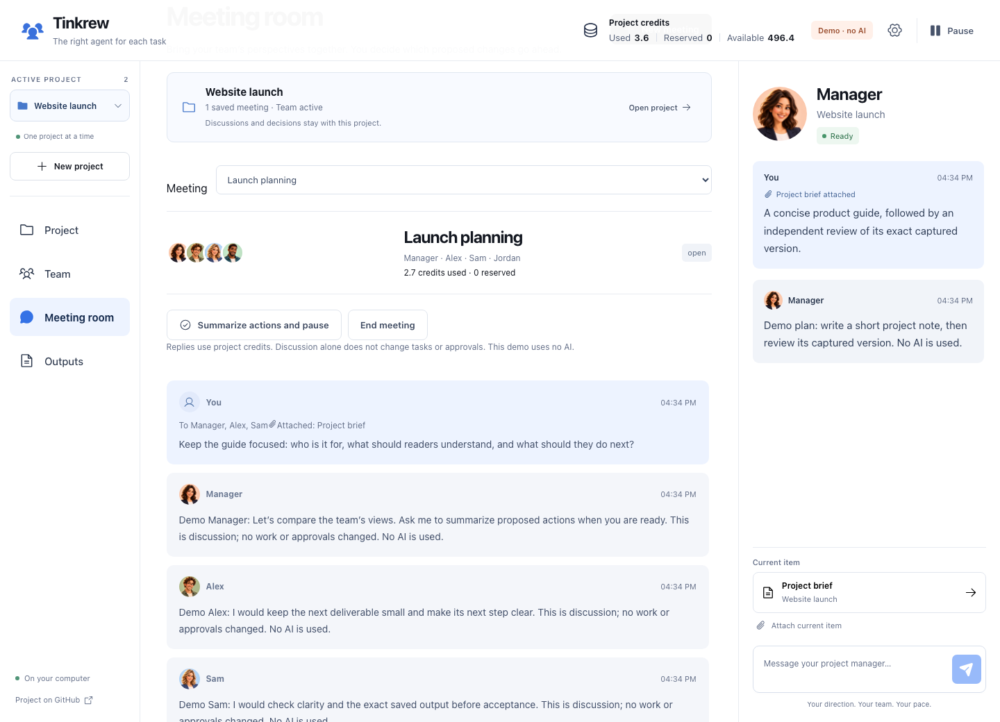
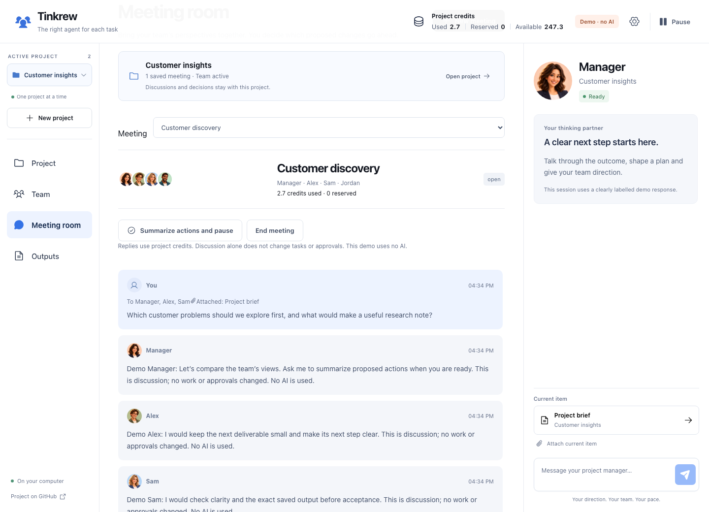
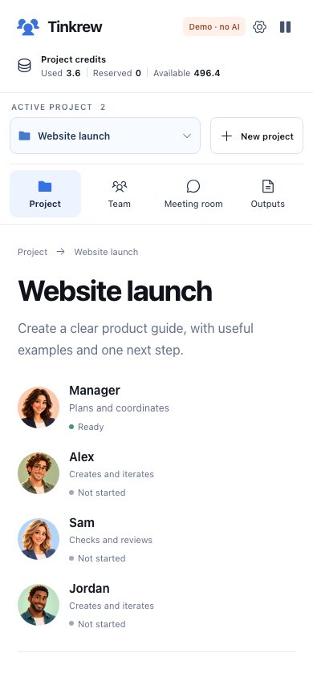

# A look inside Tinkrew

One shared AI crew, several saved projects and one active project at a time. These are fresh captures of the running application, using the built-in demo provider. They show actual controls and stored state rather than a design mockup.

**Everything shown is synthetic.** The model labels, conversations and usage figures come from a deterministic demo. No personal project, real account, live inference or external checkpoint export is used. Portraits are fictional illustrations in an animated-film style.

## Start with a clear brief

Website launch has its own brief and credit allowance. The manager has proposed a note and an independent review; the user still decides whether to approve the plan. The project dropdown and manager conversation keep the current work in context.

[](assets/workspace.png)

## Choose the people for the work

The manager coordinates; Alex builds; Sam reviews; Jordan contributes another focused building responsibility. Distinct characters make members recognizable, including people who share the same role. Model, reasoning effort and project usage remain visible in their profiles.

[](assets/team.png)

Members retain their identities across projects. Conversations, project history and usage remain separate. The demo catalog is illustrative; live model availability is discovered from the user’s compatible Codex connection.

## Bring perspectives together

Launch planning belongs to Website launch. The example contribution asks the crew to keep the first deliverable focused and reviewable. The saved demo responses demonstrate addressed discussion; proposed changes still require confirmation.

[](assets/meetings.png)

## Switch projects

Customer insights has a different brief, budget and meeting. The project dropdown changes its conversation, meeting and process state while keeping Meeting room open. The crew is shared; the project’s work stays separate. Switching pauses and drains the previous project, then opens the next without automatically connecting or resuming.

The example below is shown after explicitly connecting and resuming the demo project.

[](assets/project-switch.png)

## Keep the essentials on smaller screens

The project dropdown, credit allowance and work remain available in a narrow layout. Navigation becomes compact and the manager conversation follows the main work.

<p align="center">
  <a href="assets/mobile.png"></a>
</p>

## Reproduce the images

Screenshot capture additionally needs Playwright and Chromium. For a fresh clone, install these optional development tools without changing the project manifest or lockfile:

```sh
npm ci
npm install --no-save --package-lock=false playwright
npx playwright install chromium
npm run capture:demo
```

An existing compatible Playwright installation or the configured desktop runtime also works; see [Contributing](../CONTRIBUTING.md). The browser tool installation/cache is separate from the app’s storage budget.

The capture script starts an isolated demo on port 4187, creates disposable project folders and state, and uses fresh example content. It waits for fonts and images before capturing. The process and temporary folders are removed afterward; the saved PNGs live in `docs/assets/`. The existing app on port 4173 is left alone.

[Back to the README](../README.md) · [Data and privacy](privacy.md) · [Design language](design.md)
